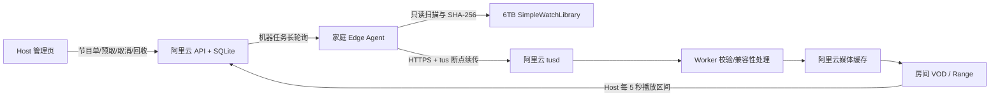

# 家庭片库按需传输与节目单运行手册

## 目标与硬边界

SimpleWatch 云端只保留近期要播放和被明确固定的影片。家庭服务器是完整片源的
唯一事实来源，主动通过 HTTPS 连接阿里云；阿里云不需要、也不能主动连接家庭
网络。

以下规则是不可放宽的系统不变量：

- 家庭专用目录固定为
  `/srv/dev-disk-by-uuid-7E82064F82060C79/PLAYS/SimpleWatchLibrary`。
- `SimpleWatchLibrary` 内只允许出现已经完整下载或完整复制的影片。
- qBittorrent 的下载中目录与 Library 物理隔离。Edge Agent 不访问 qBittorrent
  API、配置或下载目录，也不判断任何临时后缀。
- Edge Agent 对 Library 只有只读权限，没有删除、移动、改名或写入源文件的协议。
- 新出现或发生变化的文件必须连续两次扫描保持 `size + mtime` 不变后才能发布
  到云端目录。这只用于防止人工复制尚未结束，不替代“Library 只放完整影片”。
- 10TB 照片备份盘不挂载进 Agent 容器，也不参与任何目录、上传或清理流程。

## 架构



家庭端不开放入站端口。控制面采用约25秒的 HTTPS 长轮询，不使用 MQTT、
WebSocket Broker、Tailscale 或公网 IPv6 入站。长轮询返回任务后，Agent 以15秒
心跳续租；任务租约、上传凭据和 tus 断点状态都可在断网、进程重启后恢复。

## 数据与状态流

1. Agent 每5分钟扫描 Library。扫描结果先写入家庭端 SQLite 观察表。
2. 同一文件连续两次 `size + mtime` 稳定后，Agent 分页上传目录；云端只在
   `scan-commit` 的单个事务中发布新目录。未完成扫描不能把旧条目误标为缺失。
   空目录、条目/总字节骤减等异常快照还必须在家庭端和云端分别连续两次内容
   一致，才允许替换上一版有效目录；即使 Agent 状态丢失也不能单次清空云端目录。
3. Host 在“家庭片库”中搜索并加入节目单。节目单当前项和下一项进入预取窗口。
4. 云端创建传输任务，Agent 领取后重新核对路径、大小、mtime，并对完整源文件
   计算 SHA-256。
5. 云端为当前任务尝试签发可轮换的短期 tus 凭据。凭据绑定 Agent、任务、上传
   ID、尝试次数和租约，不能被其他任务复用。
6. Agent 以16MiB分块上传。失联后先用 tus `HEAD` 恢复偏移，再继续同一上传；
   任务终态重试则必须生成新的上传 ID，旧失败上传与任务解绑。
7. tus 收完后，Worker 在处理前再次计算源 SHA-256；源摘要不一致时绝不发布。
   最终媒体与源媒体摘要分别记录，以兼容合法 remux。
8. Worker 发布后，节目单变为 `ready`。Host 才能切换播放；Viewer 快照不包含
   Agent、家庭路径、传输或缓存管理信息。

## 云端容量合同

云端始终保留12GiB安全底线。预留空间按阶段计算：

```text
授权前：2 × declared_bytes
上传中：(declared_bytes - received_bytes) + declared_bytes
已收完/处理中：declared_bytes
published、incompatible、最终失败、取消：0
```

预取因空间不足进入 `blocked_storage` 后，周期对账按以下顺序恢复：

1. 重新计算真实可用空间与全部有效预留；足够时直接重试传输。
2. 不足时只选择 `eligible`、未手工固定、未在播放、家庭源仍存在的缓存。
3. 若最近一小时内没有相同源 SHA-256 的证明，先向家庭 Agent 发
   `verify_source`，不得先删云端副本。
4. 使用 `generation + rowVersion` CAS 把媒体同文件系统重命名到隔离区，再删除，
   最后提交数据库状态。中途崩溃由对账收敛。
5. 当前项、下一项、观看未完成项、手工固定项和家庭源缺失项禁止自动回收。

## 节目单与90%规则

- Host 可以从家庭目录批量加入节目单、调整顺序、取消、固定缓存和触发安全回收。
- 当前项与下一项自动预取；未就绪影片不能切换播放。
- Host 客户端每5秒上报真实连续播放区间。seek 跳过的区间不计入观看覆盖率。
- 切换时，当前影片覆盖率达到90%可直接标记看完；低于90%必须由 Host 选择
  “确认已看完”“保留未完成”或“取消切换”。
- 播放切换、房间 revision、节目单状态和历史记录在同一 SQLite 事务中完成；
  重复 `commandId` 只返回原结果，不重复切换。

## 安全模型

- Agent 机器令牌只以哈希存于云端，家庭端只通过 `0400` secret 文件注入。
- Agent 机器令牌有效期为90天；Host 在到期前14天获得预警。轮换令牌时旧令牌
  只保留5分钟重叠期，便于原子替换家庭端 secret。
- Agent 机器路由不使用浏览器 Cookie；Host 管理路由仍要求 Host 会话、可信
  Origin 和 CSRF；Viewer 调用管理路由统一返回403。
- Agent 容器无入站端口、非特权、只读根文件系统、`cap_drop: ALL`、
  `no-new-privileges`，并具有 CPU、内存和 PID 上限。
- Library 只读挂载；Agent 状态目录是唯一可写持久卷；不挂载 Docker socket。
- 日志不得记录 Authorization、上传凭据、家庭绝对文件路径或账户密码。
- Edge 离线只影响家庭目录与新传输，不得使 `/health/ready` 失败，也不影响云端
  已缓存影片播放。

## 发布顺序

### 1. 云端发布

1. 完成本地 `pnpm verify`、迁移兼容、构建、Compose合同和浏览器回归。
2. 对生产 SQLite 执行一致性备份和只读恢复验证。
3. 发布包含010–012加法迁移的新 App/Worker；保留上一发布与镜像。
4. 验证旧固定账户、现有三部媒体、上传、Range、房间、RTC和备份均未回归。
5. 用 `edge-agent-manage` 从标准输入执行 `enroll`；令牌只交付一次，不写日志。

### 2. 家庭端安装令牌

把令牌通过 SSH 标准输入交给
`tools/server/install-edge-agent-token.sh`。不要把令牌放在命令行参数、环境变量、
聊天记录或项目文件中。安装结果应为：

```text
/etc/simplewatch-edge-agent/agent-token  0400  10001:10001
```

### 3. 家庭端发布

构建产物由 Mac 生成并复制到家庭服务器的临时发布目录，然后由 root 执行：

```bash
tools/server/deploy-edge-agent.sh \
  <release-dir> \
  https://8.134.239.34 \
  <immutable-release-tag>
```

脚本会先计算 `dist/edge-agent/main.mjs` 的 SHA-256，并把发布标签与完整摘要写入
镜像 OCI label；同名镜像标签已经存在时拒绝覆盖。容器启动后还会重新计算容器内
产物摘要，确认实际运行的正是本次构建，而不是同名旧镜像。

仅有容器 `running` 不算发布成功。脚本在固定10分钟期限内还必须从本次容器的
结构化日志确认两项脱敏事件：

- `Agent 已连接控制面`：机器凭据与云端心跳已经成功；
- `家庭媒体目录已同步`：目录已经通过稳定观察并在云端完成正式 `scan-commit`。

验证只匹配上述固定消息，不打印原始容器日志；失败输出只包含心跳、提交布尔值和
警告/错误数量，不包含 token、相对路径或家庭绝对路径。超时、容器重启、摘要不
一致或任一控制面验证失败都会恢复上一版 `current`、环境、systemd 单元及 Agent
SQLite 状态，并删除失败镜像。首次部署失败则恢复到未安装状态。

成功后会在不可变发布目录生成只读的
`edge-agent-deployment-verification.txt`，记录发布标签、产物 SHA-256、镜像 ID、
心跳、目录正式提交、Library 只读和零发布端口结果。它不记录机器令牌或媒体路径。
脚本始终验证固定 Library 只读挂载、零入站端口、无 Docker socket、只读容器根
文件系统和 `10001:10001` 身份；不会写入 Library。

## 验收

必须同时通过：

- 云端原有固定账户、VOD、Range、上传、RTC与备份恢复回归。
- 机器令牌隔离、轮换、撤销与日志脱敏。
- 目录分页、扫描中断、稳定观察、删除/恢复和路径越界测试。
- 租约丢失、断网、响应丢失、凭据刷新、tus HEAD续传、取消以及48小时重试
  窗口测试；普通 API 30 秒超时、长轮询25秒加网络余量、PATCH 300秒超时，
  上传连续10分钟无字节增长才判定停滞，退避上限15分钟。
- 源 SHA、remux双摘要、重复Hook、Worker重启和旧应用兼容测试。
- Viewer 403与房间快照隐私；Host 320px、键盘和屏幕阅读器可用。
- 当前/下一项预取、低于90%三选一、seek不计覆盖、幂等切换和保护链测试。
- 空间不足、安全回收、源验证失败、CAS冲突和崩溃恢复测试。
- 实体家庭端真实只读 Library 扫描一轮；云端目录只出现完整影片。
- 家庭端发布摘要中的产物 SHA-256 与镜像 label、容器内实际文件一致；心跳与
  `scan-commit` 均为 `verified`，不能只凭容器 `running` 判定成功。

## 回滚

- 家庭端失败：先停止 `simplewatch-edge-agent.service`，切回上一个 `current`，恢复
  Agent SQLite 状态备份后再启动；Library 无需且禁止回滚。
- 云端失败：先停止 Agent 领取新任务，取消或收敛进行中 Edge 上传，再切回旧
  镜像。已发布 Edge 媒体仍是旧应用可读的普通 `published` 媒体。
- 010–012只做加法迁移，旧应用忽略新表；不得修改001–009校验和，也不得在旧
  枚举列中写入 Edge 新状态。
- 数据库恢复仅在迁移或数据本身无法收敛时执行，必须按备份手册进行，不能用
  整机快照覆盖同机 FRPS、DERP 等独立服务。
